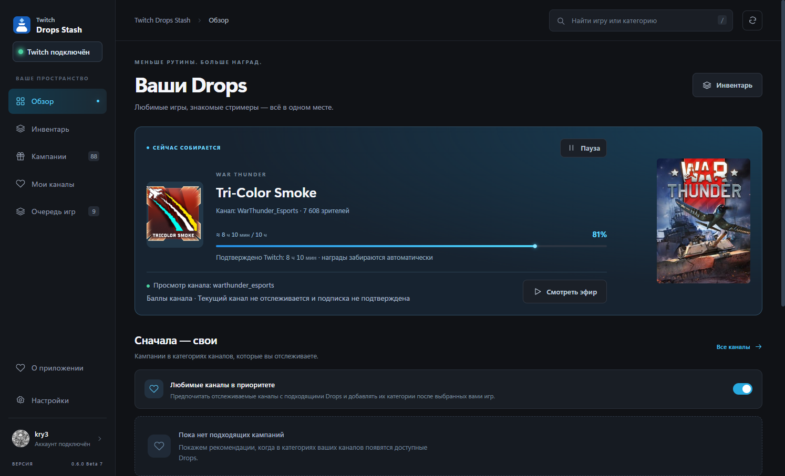
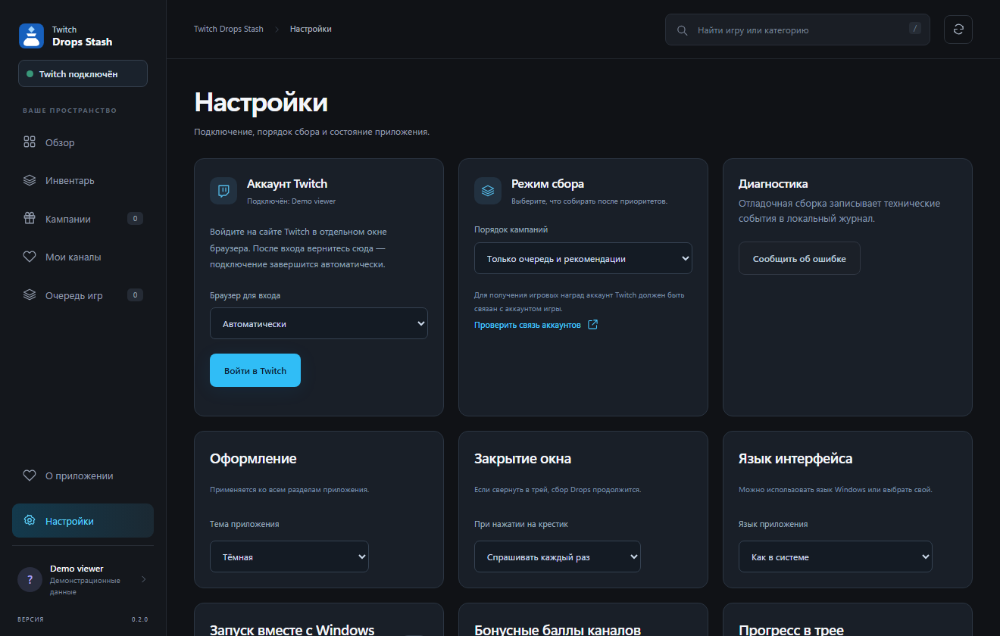
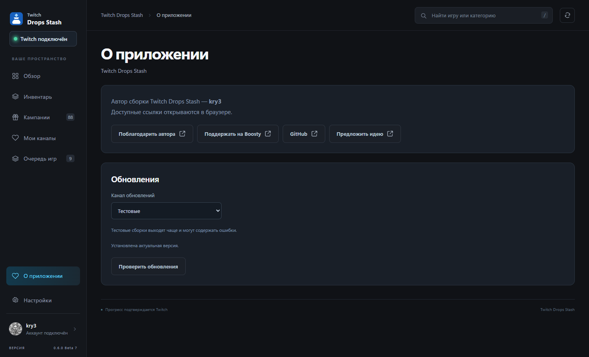

  

<h1 align="center">Twitch Drops Stash</h1>

  <strong>Windows x64 · 0.7.0 Beta 10 · Pre-release</strong> 
  <a href="#возможности">Русский</a> · <a href="#english">English</a>

Приложение для Windows, которое находит кампании Twitch Drops, отслеживает прогресс и автоматически забирает доступные награды. Обновления приходят прямо из GitHub Releases: приложение само проверяет новый выпуск, сверяет контрольную сумму, заменяет себя и откатывается, если новая сборка не запустилась.

**[Скачать 0.7.0 Beta 10 для Windows x64](https://github.com/kry3/twitch-drops-stash/releases/tag/v0.7.0-beta.10)** · [Что изменилось](https://github.com/kry3/twitch-drops-stash/releases/tag/v0.7.0-beta.10) · [Сообщить об ошибке](https://github.com/kry3/twitch-drops-stash/issues/new?template=bug-report.yml) · [Предложить идею](https://github.com/kry3/twitch-drops-stash/issues/new?template=feature-request.yml)

**Что нового в 0.7.0 Beta 10.** Пауза с длительностью: до отмены, 10 минут, час или до завтра. Уведомление в трее о полученной награде — одна сводка вместо пяти окон. Экспорт истории наград в CSV открывается в Excel. В строке состояния видно, когда Twitch последний раз отвечал: «проверено только что», «проверено 4 мин назад»; если 15 минут нет ни ответов, ни прогресса, появляется жёлтая плашка «Похоже, Twitch не отвечает» с кнопкой «Переподключиться». Про баллы канала в этой сборке есть точный ответ: минута просмотра отправляется, но **начисление баллов этим способом не подтверждено** — подробности в заметках к выпуску.

## Скриншоты

Обзор показывает текущую награду, прогресс и очередь игр. В настройках — язык, оформление, вид прогресса и работа в трее. В «О приложении» — канал обновлений и проверка новой версии.

## Возможности

- **Сбор наград.** Приложение подбирает подходящий канал, переключается при завершении трансляции и забирает награду, когда Twitch подтверждает прогресс.
- **Обновления из этого репозитория.** «О приложении» → «Проверить обновления»: версия, список изменений, скачивание с проверкой SHA-256, установка с перезапуском и откатом.
- **Очередь игр и каналы.** Свой порядок игр, приоритет отслеживаемых каналов, обзор активных и предстоящих кампаний.
- **Инвентарь.** Награды и подтверждённый Twitch прогресс, просмотр трансляции, ссылки на привязку аккаунтов.
- **Работа в фоне.** Свернуть в трей, подсказка о прогрессе, запуск вместе с Windows.
- **Интерфейс.** Русский и английский, светлая и тёмная темы, выбор вида прогресса.

## Как это работает

После входа приложение загружает доступные кампании, выбирает подходящую трансляцию по очереди игр и отслеживает прогресс по данным Twitch. Если эфир закончится, оно подберёт другой подходящий канал. Когда Twitch подтвердит условия, приложение заберёт награду. Баллы канала оно читает и сообщает Twitch о просмотренной минуте, но начисление баллов этим способом не подтверждено, а забор бонусов остаётся экспериментальным.

## Первый запуск

1. Скачайте [ZIP для Windows x64](https://github.com/kry3/twitch-drops-stash/releases/tag/v0.7.0-beta.10) и распакуйте в отдельную папку с правом записи.
2. Запустите **Twitch Drops Stash.exe**. Нужен Microsoft Edge WebView2 Runtime (в Windows 11 он уже есть).
3. Войдите в Twitch через браузер. Для кампаний с привязкой свяжите аккаунт Twitch с аккаунтом игры.

Сборку проверяли на Windows 11 x64. Windows 10 x64 и Windows 11 ARM64 ещё требуют проверки. Подписи издателя пока нет, поэтому Windows может показать предупреждение при первом запуске.

## Обновления

Обновления приходят из выпусков этого репозитория. В «О приложении» есть канал: **Стабильные** или **Тестовые** — тестовые сборки предлагаются только на тестовом канале, выбор сохраняется.

- «Проверить обновления» показывает версию, список изменений и размер.
- «Скачать обновление» кладёт архив во временную папку приложения и сверяет SHA-256 с опубликованной суммой.
- «Установить и перезапустить» закрывает приложение, сохраняет прежний EXE как `Twitch Drops Stash.exe.bak-update`, ставит новый и запускает его. Если новая сборка не подтвердила работу интерфейса, помощник вернёт прежний EXE.
- Итог установки — в `updates\result.json` и `updates\updater.log` рядом с EXE.

**Обновление с 0.2.0 Beta 2 вручную.** Полностью выйдите из приложения, сохраните копию старого EXE и замените его новым из ZIP. Сессия Twitch, настройки и собранные часы сохранятся.

## Тестирование и обратная связь

Особенно полезны отчёты о первом входе, сборе и получении наград, работе трея, автозапуска, смены языка и обновления с предыдущей версии.

При ошибке откройте [GitHub Issue](https://github.com/kry3/twitch-drops-stash/issues) и укажите версию Windows, шаги воспроизведения и результат. В ZIP есть инструкция по сохранению диагностического отчёта — проверьте его содержимое перед публикацией.

SHA-256 ZIP `3735219D30BAD1797E68949319684F595B1FC6E0AFCAD2245BBECE5D825D49A4`

---

## English

Twitch Drops Stash is a Windows app that finds Twitch Drops campaigns, tracks progress, and automatically claims eligible rewards. Updates come straight from GitHub Releases: the app checks for a new release, verifies its checksum, replaces itself, and rolls back if the new build does not start.

**[Download 0.7.0 Beta 10 for Windows x64](https://github.com/kry3/twitch-drops-stash/releases/tag/v0.7.0-beta.10)** · [Report a bug](https://github.com/kry3/twitch-drops-stash/issues/new?template=bug-report.yml) · [Suggest an idea](https://github.com/kry3/twitch-drops-stash/issues/new?template=feature-request.yml)

**What's new in 0.7.0 Beta 10.** Pause with a duration: until cancelled, 10 minutes, an hour, or until tomorrow. A tray notification for a claimed reward — one summary instead of five popups. Reward history exports to CSV and opens in Excel. The status line says when Twitch last answered — "checked just now", "checked 4 min ago" — and after 15 minutes with no answers and no progress a yellow note appears: "Twitch seems to be silent", with a Reconnect button. Channel points get a precise answer in this build: the watched minute is sent, but **earning points this way is not confirmed** — see the release notes.

The overview shows the current reward, progress, and the game queue. Settings cover language, appearance, progress display, and tray behaviour. About holds the update channel and the version check.

### Features

- **Claiming.** The app picks an eligible channel, switches when the stream ends, and claims the reward once Twitch confirms progress.
- **Updates from this repository.** About → Check for updates: version, change list, a checksum-verified download, install with restart, and rollback.
- **Game queue and channels.** Your own game order, followed-channel priorities, and an overview of active and upcoming campaigns.
- **Inventory.** Rewards and confirmed Twitch progress, the stream viewer, and account-linking links.
- **Background work.** Minimize to tray, progress tooltip, and start with Windows.
- **Interface.** Russian and English, light and dark themes, and a choice of progress display.

### Getting started

1. Download the [Windows x64 ZIP](https://github.com/kry3/twitch-drops-stash/releases/tag/v0.7.0-beta.10) and extract it to a writable folder.
2. Run **Twitch Drops Stash.exe**. Microsoft Edge WebView2 Runtime is required (Windows 11 ships it).
3. Sign in to Twitch in your browser. Link your Twitch and game accounts if the campaign requires it.

Windows 11 x64 has been tested. Windows 10 x64 and Windows 11 ARM64 still need testing. There is no publisher signature yet, so Windows may warn on first start.

### Updates

Updates come from this repository's releases. About has a channel: **Stable** or **Test**; test builds are offered only on the test channel, and the choice is remembered.

- Check for updates shows the version, the change list, and the size.
- Download update puts the archive in the app's temporary folder and compares SHA-256 with the published sum.
- Install and restart closes the app, keeps the previous EXE as `Twitch Drops Stash.exe.bak-update`, installs the new one, and starts it. If the new build does not confirm its interface, the helper restores the previous EXE.
- The outcome is written to `updates\result.json` and `updates\updater.log` next to the EXE.

**Updating from 0.2.0 Beta 2 by hand.** Exit the app completely, back up the old EXE, and replace it with the new one from the ZIP. Your Twitch session, settings, and watch time are preserved.

### Testing and feedback

Reports about first sign-in, Drops progress and claiming, the tray, autostart, language switching, and updating from a previous version are especially useful.

For a bug, open a [GitHub issue](https://github.com/kry3/twitch-drops-stash/issues) with your Windows version, the steps to reproduce, and what happened. The ZIP explains how to save a diagnostic report — review it before sharing.

SHA-256 ZIP `3735219D30BAD1797E68949319684F595B1FC6E0AFCAD2245BBECE5D825D49A4`

---

Сборка / Build by **kry3**. Основано на / Based on [TwitchDropsMiner by DevilXD](https://github.com/DevilXD/TwitchDropsMiner). Лицензия / License: [MIT](./LICENSE).
